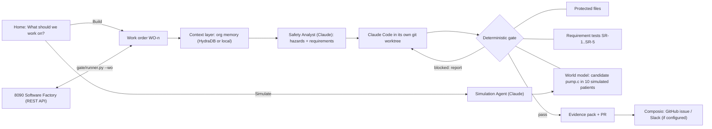

# Certus Factory

**A software factory for safety-critical code.** You say what you want in plain English. An agent team recalls the
organization's memory, maps the request to hazards, and has Claude Code write the change in its own git worktree.
Then deterministic checks decide whether it ships: the unit test behind every safety requirement the diff touches
(e.g. SR-1 "single bolus never exceeds 10 U", hazard H-1 overdose), and a world model that runs the candidate's real
C code in simulated type 1 diabetic patients (simglucose). If a check fails, the report goes back to the agent. If
everything passes, the change ships with a safety evidence pack and a PR. Approval is never an LLM decision. The
demo codebase is a small insulin-pump controller in C (not a medical device). The project is modelled on 8090's
Software Factory and adds CertusAI-style safety traceability.

Built at EVOLVE, the 8090 AI Hackathon (Nov 13–14, 2026). Devpost write-up: [docs/DEVPOST.md](docs/DEVPOST.md).
Hosted read-only backup: https://certus-factory.vercel.app

## Architecture



The LLM steps plan, write code and suggest hazards. Only the exit codes of the checks in `gate/checks.json` decide
approval. If an LLM call fails, the run continues with a deterministic fallback and the UI says so.

## Quickstart

**Prerequisites:**

- macOS or Linux with Python 3.10+, Node 18.18+ and npm, `make`, a C compiler, and `git`.
- For live mode: the `claude` CLI logged in, or `ANTHROPIC_API_KEY` set.
- To open PRs: the `gh` CLI.

```bash
git clone https://github.com/Abhishek21g/evolve-factory && cd evolve-factory
demo/go.sh replay      # first run ~1.5 min (venv, npm ci, UI build), then ~3 s; ends with READY
```

Open http://localhost:8787/#/p/insulin-pump-firmware/overview, type `Raise the single-bolus limit to 25 U`, and press Enter.

- `demo/go.sh replay` plays a recorded real run (WO-304), so nothing waits on an LLM. It needs no keys.
- `demo/go.sh live` runs real agents. A work order takes about 2.5–3.5 minutes, and a what-if about 45 s.
- `demo/go.sh check` runs the health check only.

`go.sh` creates `.venv`, builds `web/`, seeds the demo project and a draft work order, pre-warms the simulator and
the C build, starts `factory/server.py`, and prints READY or exactly what's broken. Re-running it is safe.

You can override these settings with environment variables:

- `PORT` (default 8787).
- `FACTORY_PR=1`: live runs open a GitHub PR.
- `REPLAY_SPEED`, `REPLAY_HOLD`: replay pacing (see [docs/DEMO.md](docs/DEMO.md)).

**Keys (optional).** Put them in `.env` at the repo root; it's gitignored. Without keys, the factory runs on local fallbacks.

| Name | Used for |
|---|---|
| `ANTHROPIC_API_KEY` | Live mode: Claude Code, Safety Analyst, Simulation Agent (otherwise the logged-in `claude` CLI) |
| `HYDRADB_API_KEY` | Org memory in HydraDB (otherwise a local JSONL store) |
| `COMPOSIO_API_KEY`, `COMPOSIO_GITHUB_AUTH_CONFIG`, `COMPOSIO_SLACK_AUTH_CONFIG`, `SLACK_CHANNEL` | GitHub issue and Slack update after each run; connect once with `.venv/bin/python factory/actions.py connect` |
| `SF_API_KEY` | 8090 Software Factory External API (`sofa-ext-...`); check with `python3 gate/sf.py health` |

## Demo flow (3 minutes)

The full script is in [docs/DEMO.md](docs/DEMO.md), and the spoken pitch is in [docs/PITCH.md](docs/PITCH.md).

1. **Home.** Type the request with **Build** selected. A work order opens, and the hazard analysis maps it to H-1, H-2 and H-3. It flags that the request directly violates SR-1.
2. **Blocked.** Attempt 1 is the obvious one-line patch `MAX_BOLUS_U 10 -> 25`. It's scripted by `demo/obvious_patch.sh`, because Claude Code wouldn't write it. SR-1 fails, and the world model shows 4 simulated patients falling below 54 mg/dL after a 10x dose typo.
3. **Blocked again.** Attempt 2 is real Claude Code's extended bolus at 10 U/h. All 5 requirement tests pass, but 2 patients crash hours after a large meal.
4. **Green.** Attempt 3 is real Claude Code capping the extended total. 5/5 tests pass and there are 0 new severe lows; 2 pre-existing lows on `main` are flagged as a new hazard. Open **Evidence** and **Pull request** ([#30](https://github.com/Abhishek21g/evolve-factory/pull/30)).
5. **Optional.** Switch to **Simulate** and ask "What if a child eats 80 g and the parent types the dose 10x?". You can also browse **Agents**, **Memory**, **Traceability** and **Audit trail**.

## Run the pieces on their own

```bash
.venv/bin/python gate/test_gate.py                     # gate self-test
.venv/bin/python sim/world.py --repo . --base main     # world model on main, ~25 s
.venv/bin/python factory/memory.py bolus limit         # org memory recall
.venv/bin/python factory/pipeline.py whatif "What if an adult eats 150 g of carbs?"   # needs Claude; else a parsed fallback
```

## Repo layout

| Path | What's in it |
|---|---|
| `factory/` | `server.py` (API and static UI), `pipeline.py` (build / what-if / replay), `memory.py` (HydraDB or local), `actions.py` (Composio), `store.py` (projects, work orders, audit trail), `seed_memory.jsonl` (example org memory written for the demo) |
| `gate/` | `runner.py` (Claude Code in a worktree, retry on BLOCKED, PR), `gate.py` (diff to requirements to tests), `check_protected.py`, `checks.json`, `sf.py` (Software Factory REST client) |
| `sim/` | `world.py` (world model: candidate `pump.c` in simglucose patients), `shim.c`, `agent.py` (standalone Simulation Agent on the Anthropic API) |
| `demo/pump/` | Demo pump controller in C, `safety.json` (hazards H-1..H-5, requirements SR-1..SR-5), requirement tests |
| `demo/` | `go.sh`, `health.py`, `replay/` (recorded run), `record.py`, `deploy.sh` (Vercel), `obvious_patch.sh` |
| `web/` | Static Next.js UI: Home, Agents, Memory, Work Orders, Requirements, World Model, Traceability, Audit trail |
| `dashboard/` | Earlier agent control room and the shared event feed (`emit.py`) |
| `docs/` | `PLAN.md`, `DEMO.md`, `PITCH.md`, `DEVPOST.md`, `SAFETY_GATE.md`, `RESEARCH.md` |

## Tools, libraries and licenses

| Tool / library | Use | License |
|---|---|---|
| Python 3 standard library | server, gate, pipeline | PSF |
| git, make, C compiler (clang/gcc) | worktrees, diffs, building the pump code | tools only, not bundled |
| Claude Code (Anthropic) | coding agent in the loop; also used to build this project | Anthropic commercial terms |
| Anthropic Python SDK (anthropic 2.8.0) + Claude API | Simulation Agent (`sim/agent.py`) | MIT SDK; API under Anthropic commercial terms |
| 8090 Software Factory (External REST API) | work orders, status, PR link (`gate/sf.py`) | 8090 service (event access) |
| simglucose 0.2.11 (UVA/Padova T1D simulator) | world model | MIT |
| numpy, pandas, scipy (simglucose deps) | simulation | BSD-3-Clause |
| Next.js 15, React 19, Tailwind CSS 4 | web UI | MIT |
| HydraDB (hydradb-sdk) | org memory / context layer | proprietary SDK, hosted service (sponsor) |
| Composio (composio 0.32) | GitHub / Slack actions | Apache-2.0 (sponsor) |
| Vercel | hosting the read-only UI | service (sponsor) |
| GitHub CLI (`gh`) | opening PRs | MIT, tool only |
| Cursor, Codex CLI | IDE and coding agents used while building | proprietary / Apache-2.0 |

## Built before the event

Nothing. All code and commits in this repo were made during EVOLVE (hacking started Fri Nov 13, 7:10 PM PT). Ideas
were planned beforehand, which the rules allow. No code from CertusAI (our separate startup) is used.

Team: Abhishek Enaguthi ([@Abhishek21g](https://github.com/Abhishek21g)), Muralikrishna Inti ([@Muralikinti](https://github.com/Muralikinti)).

## License

MIT, see [LICENSE](LICENSE).
