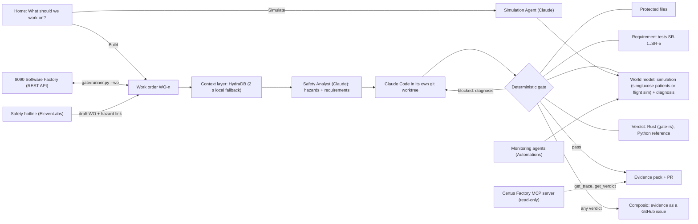

# Certus Factory

**A software factory for safety-critical code.** You say what you want in plain English. An agent team recalls the
organization's memory (HydraDB), maps the request to hazards, and has Claude Code write the change in its own git
worktree. Then deterministic checks decide whether it ships:

- the test behind every safety requirement the diff touches (e.g. SR-1 "single bolus never exceeds 10 U", hazard H-1 overdose);
- a world model that runs the candidate's real compiled C code in simulation: simulated type 1 diabetic patients
  (simglucose) for the insulin pump, simulated 737-class aircraft for flight controls.

If a check fails, the report goes back to the agent. If everything passes, the change ships with a safety evidence
pack and a PR, and Composio files the evidence on GitHub. Approval is never an LLM decision. The project is modelled
on 8090's Software Factory and adds CertusAI-style safety traceability.

**Why not just Claude Code?** Claude is the builder; we're the inspector. Claude Code writes the change, and the
factory adds what a regulated team needs before merge:

- a deterministic gate the LLM can't talk past, made of tests and exit codes the agent can't edit;
- simulation evidence that the real code doesn't harm a simulated patient or aircraft;
- traceability from request to hazard to requirement to test to PR;
- an evidence pack for every change, including the blocked ones.

Built at EVOLVE, the 8090 AI Hackathon (Nov 13–14, 2026). Devpost write-up: [docs/DEVPOST.md](docs/DEVPOST.md).
Hosted read-only backup: https://certus-factory-ten.vercel.app

Demo video: (link coming)

## Architecture



The LLM steps plan, write code and suggest hazards. Only the exit codes of the project's checks decide approval:
`gate/checks.json` for the pump, `gate/checks-aircraft.json` for flight controls. If an LLM or sponsor call fails, the
run continues with a fallback and the UI says so.

The final PASS/BLOCKED is decided by a small Rust binary (`gate-rs/`, `#![forbid(unsafe_code)]`, no panics). It takes
the rule table, the check outcomes, the requirement test results and the world-model results, and returns every
requirement with its hazard links plus a SHA-256 verdict digest. Its property tests run it against 40,000 generated
cases (no unsafe evidence ever passes; tampered evidence never panics and always changes the digest). Without cargo,
the identical Python reference in `gate/verdict.py` decides, and `gate/test_gate.py` checks that the two agree on
every recorded run.

**World model vs simulation.** The *simulation* is the physics: `sim/world.py` (simglucose patients) and
`sim/flight.py` (737-class aircraft) run the candidate's compiled C code in the loop and return one time series per
run. The *world model* (`factory/worldmodel.py`) is the layer on top: scenarios go in (gate scenarios, what-ifs, fault
injection), the simulation runs them, and it finds where a run left the safe envelope and diagnoses it from the trace
and the code: which requirement and hazard broke, when, through which causal chain, and which code lines are
responsible. That diagnosis goes back to the coding agent, and the loop re-runs until the world model passes
(sidebar **World Model**). No LLM in it.

**Monitoring agents** (sidebar **Automations**) run on schedules in the server, deterministic, no LLM:
Reliability monitor (every 15 min: simulation regression suite and every requirement test on `main`), Requirements
drift monitor (every 10 min: resyncs the **Source of Record**, where `safety.json` is the single source of truth and
each requirement is checked against its test, the value in the code, its trace links and fresh simulation evidence),
Fault-injection runner (nightly: adversarial scenarios from the certified limits, every failure diagnosed) and
Supplier compliance monitor (hourly, sample supplier data). Each has **Run now** and a run history with evidence.

## Projects

Pick a project with the project switcher in the sidebar.

| Project | Code | Hazards / standards | World model | Stage request |
|---|---|---|---|---|
| Insulin Pump Firmware | `demo/pump/` (small C controller, not a medical device) | H-1..H-5, SR-1..SR-5; IEC 62304 / ISO 14971 | `sim/world.py`: simglucose, 10 virtual adults, large meal + 10x dose typo over 12 h; blocks on any new BG < 54 mg/dL | `Raise the single-bolus limit to 25 U` |
| Boeing Flight Controls | `demo/aircraft/` (AoA stall protection in C, built at the hackathon) | H-1..H-5 with severity and DAL (ARP4761 FHA), SR-1..SR-5 with DO-178C objectives; context in [docs/BOEING.md](docs/BOEING.md) | `sim/flight.py`: plain-Python longitudinal flight model, 3 scenarios x 6 configs; blocks on any new stall or altitude-loss exceedance | `Add AoA disagree alert when the two sensors differ by more than 5 degrees` |

The aerospace project exists because Boeing asked CertusAI about DO-254. Boeing is not a customer, and this isn't
Boeing code or data.

## Quickstart

**Prerequisites:**

- macOS or Linux with Python 3.10+, Node 18.18+ and npm, `make`, a C compiler, and `git`.
- For live mode: the `claude` CLI logged in, or `ANTHROPIC_API_KEY` set.
- To open PRs: the `gh` CLI.

```bash
git clone https://github.com/Abhishek21g/evolve-factory && cd evolve-factory
demo/go.sh replay      # first run ~1.5 min (venv, npm ci, UI build), then ~3 s; ends with READY
```

Then open one of these. The app opens on a **Sign in** page; `?demo` in the URL skips it and enters the demo workspace
(or click **Enter demo workspace**). Email sign-in works too: with no `CERTUS_DEMO_PASSWORD` set, any work email
signs in. Sessions are HMAC-signed, and every sign-in and sign-out lands in the audit trail. SSO and GitHub sign-in
show what an admin would need to configure; they aren't wired up.

- **Pump:** http://localhost:8787/?demo#/p/insulin-pump-firmware/overview. Type `Raise the single-bolus limit to 25 U` and press Enter.
- **Aircraft:** http://localhost:8787/?demo#/p/boeing-flight-controls/overview. Type the AoA request above.

The `go.sh` modes:

- `demo/go.sh replay` plays each project's recorded real run, so nothing waits on an LLM. It needs no keys.
- `demo/go.sh live` runs real agents and pre-warms every Home suggestion in the background. A cold work order takes a few minutes, and a what-if about a minute; repeats answer instantly from their cached real run.
- `demo/go.sh check` runs the health check only.

`go.sh` creates `.venv`, builds `web/`, seeds the projects and a draft work order, pre-warms the simulator and the C
build, starts `factory/server.py`, and prints READY or exactly what's broken. Re-running it is safe.

You can override these settings with environment variables:

- `PORT` (default 8787).
- `FACTORY_PR=1`: live runs open a GitHub PR.
- `REPLAY_SPEED`, `REPLAY_HOLD`: replay pacing (see [docs/DEMO.md](docs/DEMO.md)).

**Keys (optional).** Put them in `.env` at the repo root; it's gitignored. Without keys, the factory runs on local fallbacks.

| Name | Used for |
|---|---|
| `ANTHROPIC_API_KEY` | Live mode: Claude Code, Safety Analyst, Simulation Agent (otherwise the logged-in `claude` CLI) |
| `HYDRADB_API_KEY` | Org memory recall in HydraDB; seeded from local memory on server start (otherwise a local JSONL store). Optional: `HYDRADB_DATABASE` |
| `COMPOSIO_API_KEY` | Files each verdict's evidence pack as a GitHub issue. Connect GitHub once: Home → **Connect GitHub**. Optional: `COMPOSIO_USER_ID` |
| `SF_API_KEY` | 8090 Software Factory External API (`sofa-ext-...`); check with `python3 gate/sf.py health` |
| `ELEVENLABS_API_KEY` | Live safety hotline (run `factory/hotline.py setup` once). The callout clips and a recorded hotline call are committed, so playback needs no key |
| `CERTUS_DEMO_EMAIL`, `CERTUS_DEMO_PASSWORD` | Optional: only this account signs in by email (otherwise any email does). `CERTUS_SESSION_SECRET` optional |

## Demo flow (about 2:45, replay mode)

The click-by-click script is in [docs/DEMO.md](docs/DEMO.md), and the spoken pitch is in [docs/PITCH.md](docs/PITCH.md).
The stage and the video use `demo/go.sh replay` only: every run plays a recorded real run, and nothing calls an LLM.

1. **Sign in.** Open `http://localhost:8787/`, click **Enter demo workspace**, then **Insulin Pump Firmware**.
2. **Build (pump).** Type `Raise the single-bolus limit to 25 U` with **Build** selected and press Enter. A work order opens, and the hazard analysis maps it to H-1, H-2 and H-3 and flags that it breaks SR-1.
3. **Blocked.** Attempt 1 is the obvious patch `MAX_BOLUS_U 10 -> 25`, scripted by `demo/obvious_patch.sh`, because Claude Code wouldn't write it. SR-1 fails, and 4 simulated patients newly fall below 54 mg/dL.
4. **Blocked again.** Attempt 2 is real Claude Code's extended bolus. All 5 tests pass, but 2 patients crash hours after a large meal.
5. **Green.** Attempt 3 is real Claude Code capping the extended total. 5/5 tests pass and there are 0 new severe lows. Open **Code change** and **Evidence**.
6. **World model loop.** Hear the pump before vs after (ElevenLabs voices on alarms derived from the trace by code), then the diagnosis that went back to the coder.
7. **Traceability.** Matrix, then **Graph**, then click **H-1** to light its chain.
8. **Boeing Flight Controls.** Switch project, open **Incidents**, play the recorded hotline call, then **Control Tower** (sample supply and finance data, labelled) and **Integrations** (Certus Factory as an MCP server).

The recorded aircraft run (AoA disagree alert): attempt 1 lowers the certified 5.5 deg monitor to 5 deg (scripted by
`demo/aircraft/obvious_patch.sh`), SR-3 fails and all 6 aircraft stall in the sideslip approach; attempt 2 is Claude
Code adding a separate alert-only threshold, 5/5 pass, 0 new exceedances ([#41](https://github.com/Abhishek21g/evolve-factory/pull/41)).

## What's in the UI

| Page | What it shows |
|---|---|
| Sign in | Demo workspace, email sign-in (signed session), SSO / GitHub dialogs that say what an admin must configure. `?demo` skips it. User menu (bottom left): switch person, **Integrations**, **Sign out** |
| Control Tower | Every project at a glance (sidebar **Control Tower** under All projects), or one project: software building, physical-AI safety, supply chain and finance tiles, with a one-sentence deterministic status. Supply and finance numbers are sample data and say so |
| Home | Greeting, one "What should we work on?" box with Build / Simulate, suggestions, the agent team, recent work orders, and connection status |
| Agents | Working team view. Each agent's page shows now, live log, output, skills and history |
| Memory | HydraDB: org memory, the project's regulatory knowledge base and the lessons from past verdicts; search (recall) and add |
| Requirements | The hazard log and safety requirements of the project (`safety.json`) |
| Work Orders | Each run: hazard analysis, attempts, gate matrix, world model, evidence pack, code change, PR |
| World Model | The loop of a work order: scenario, simulation, deterministic diagnosis (requirement, hazard, causal chain, responsible code lines), sent to the coder, fix, re-simulation. "Hear the pump / cockpit: before vs after" plays the alarms or cockpit callouts of the failing and the fixed run |
| Simulations | Real charts per simulated run. Pump: glucose per virtual patient, candidate vs `main`, the 70–180 band, the 54 and 250 lines, insulin delivered by `pump.c`. Aircraft: AoA vs the stall line. Plain-English what-ifs |
| Traceability | Matrix and graph per project: regulation clause → hazard → requirement → code lines → test → simulation scenario → work order → evidence. Code opens at the exact lines (and on GitHub), docs at the section; people add or remove links (`trace/links-<device>.json`); gaps auditors look for are flagged red |
| Source of Record | `safety.json` as the single source of truth, resynced against code, tests, trace links and simulation evidence; drift is flagged per requirement |
| Automations | The four monitoring agents above: schedule, **Run now**, run history, findings and evidence |
| Incidents | Safety hotline (ElevenLabs agent): a call becomes a draft work order, a HydraDB memory item and a trace link to the most likely hazard. The recorded sample call plays on Boeing Flight Controls |
| Suppliers, Supply Chain, Finance | Sample data, labelled as such: supplier tiers, certificates and deliverables (a submitted deliverable becomes a real trace link), parts, raw materials, imports and risk flags, factory spend vs budget, cost per work order |
| Audit Trail, Team | Who (human or agent) did what; the people and agents on the project |
| Integrations | Connected tools, the Composio plugin catalog (real Connect links), requirements/ALM imports (coming soon), MCP servers (add, test) and Certus Factory as an MCP server |

## Integrations and MCP

Certus Factory is itself a read-only MCP server (`factory/mcp_server.py`) with five tools: `list_projects`,
`get_trace` (a requirement's hazards, code, test, simulations, work orders), `get_verdict` (a work order's merge
verdict and evidence), `list_gaps` and `recall_memory` (HydraDB). Nothing it exposes writes. It runs over stdio, or
over HTTP at `/mcp` while the factory server runs. Cursor (`~/.cursor/mcp.json` or `.cursor/mcp.json`):

```json
{
  "mcpServers": {
    "certus-factory": { "command": "/path/to/evolve-factory/.venv/bin/python", "args": ["/path/to/evolve-factory/factory/mcp_server.py"] }
  }
}
```

Claude Code: `claude mcp add certus-factory -- /path/to/evolve-factory/.venv/bin/python /path/to/evolve-factory/factory/mcp_server.py`,
or over HTTP: `claude mcp add --transport http certus-factory http://localhost:8787/mcp`. The Integrations page shows
these with the real paths filled in, and **Test connection** lists the tools. Other MCP servers can be added there
(HTTP ones are tested with `initialize` + `tools/list`; stdio ones are listed but never started from the browser).

Sponsor tools and what they do here:

- **HydraDB:** three collections in one database: `org_memory` (tickets, meetings, chats, emails, code notes, incidents), `regulatory_kb` (standards and each project's hazard log) and `factory_lessons` (one lesson per finished work order). The Context step and the Safety Analyst recall from it; the Plan step recalls lessons from similar past work orders; the Memory page searches it; the MCP server's `recall_memory` uses it. 2 s timeout, local JSONL fallback.
- **Composio:** files each verdict's evidence pack as a GitHub issue (fire-and-forget), files a GitHub issue when a supplier deliverable is recorded, and powers the Integrations plugin catalog with real Connect links.
- **ElevenLabs:** voices for the pump alarms and cockpit callouts (a fixed clip catalog, committed in `web/public/audio/`), and the safety hotline agent (`factory/hotline.py`, a `create_incident` client tool; recorded sample call in `web/public/hotline/`).
- **Vercel:** hosts the read-only snapshot.

## Run the pieces on their own

```bash
.venv/bin/python gate/test_gate.py                            # gate self-test, incl. Rust/Python verdict parity
.venv/bin/python gate/test_sf.py                              # Software Factory client
for t in tracelinks mcp auth supply worldmodel whatif_title; do .venv/bin/python factory/test_$t.py; done   # factory self-tests
(cd gate-rs && cargo test --release)                          # Rust verdict layer: unit + property tests (40,000 generated cases)
PORT=8931 demo/go.sh replay && (cd web && QA_URL=http://localhost:8931 npm run qa)   # UI: every page, both projects, click sweep
make -s -C demo/aircraft test                                 # aircraft requirement tests
.venv/bin/python sim/world.py --repo . --base main            # pump world model on main, ~25 s
.venv/bin/python sim/flight.py --repo . --base main           # flight world model on main, ~1 s
.venv/bin/python factory/memory.py stall protection AoA       # org memory recall (HydraDB if the key is exported)
.venv/bin/python factory/pipeline.py whatif "What if an adult eats 150 g of carbs?"   # needs Claude; else a parsed fallback
.venv/bin/python factory/mcp_server.py                        # Certus Factory MCP server on stdio
```

## Repo layout

| Path | What's in it |
|---|---|
| `factory/` | `server.py` (API and static UI), `pipeline.py` (build / what-if / replay / pre-warm), `worldmodel.py` (diagnosis and fix loop), `monitors.py` (monitoring agents), `record.py` (source of record), `tracelinks.py` (traceability), `memory.py` (HydraDB + local fallback), `actions.py` / `integrations.py` (Composio, MCP servers), `mcp_server.py` (Certus Factory as an MCP server), `callouts.py` / `hotline.py` / `incidents.py` (ElevenLabs), `supply.py` (sample supply and finance data), `auth.py` (sign-in), `store.py` (projects, work orders, audit trail), `seed_memory.jsonl` (example org memory written for the demo) |
| `gate/`, `gate-rs/` | `runner.py` (Claude Code in a worktree, retry on BLOCKED, PR), `gate.py` (diff to requirements to tests), `verdict.py` (verdict layer: Rust binary or Python reference), `check_protected.py`, `checks.json` / `checks-aircraft.json`, `sf.py` (Software Factory REST client); `gate-rs/` is the Rust verdict layer |
| `sim/` | `world.py` + `shim.c` (pump in simglucose), `flight.py` + `fcc_shim.c` (flight model), `agent.py` (standalone Simulation Agent on the Anthropic API) |
| `demo/pump/`, `demo/aircraft/` | The two codebases: C code, `safety.json` (hazards and requirements), requirement tests, obvious patches; `demo/aircraft/RULES.md` (coding-agent rules) |
| `demo/` | `go.sh`, `health.py`, `replay/` (recorded runs per project), `record.py`, `deploy.sh` (Vercel) |
| `web/` | Static Next.js UI; `web/qa/` Playwright suite (`npm run qa`) |
| `dashboard/` | Earlier agent control room and the shared event feed (`emit.py`) |
| `docs/` | `PLAN.md`, `DEMO.md`, `PITCH.md`, `DEVPOST.md`, `BOEING.md`, `HOTLINE.md`, `TRACEABILITY.md`, `SAFETY_GATE.md`, `RESEARCH.md` |

## Tools, libraries and licenses

| Tool / library | Use | License |
|---|---|---|
| Python 3 standard library | server, gate, pipeline, flight model | PSF |
| git, make, C compiler (clang/gcc) | worktrees, diffs, building the C code | tools only, not bundled |
| Claude Code (Anthropic) | coding agent in the loop; also used to build this project | Anthropic commercial terms |
| Anthropic Python SDK (anthropic 2.8.0) + Claude API | Simulation Agent (`sim/agent.py`) | MIT SDK; API under Anthropic commercial terms |
| 8090 Software Factory (External REST API) | work orders, status, PR link (`gate/sf.py`) | 8090 service (event access) |
| simglucose 0.2.11 (UVA/Padova T1D simulator) | pump world model | MIT |
| numpy, pandas, scipy (simglucose deps) | simulation | BSD-3-Clause |
| Next.js 15, React 19, Tailwind CSS 4, shadcn/ui (Radix), Geist, lucide-react, React Flow (@xyflow/react) | web UI | MIT |
| Rust (stable), cargo | gate verdict layer (`gate-rs/`) | MIT / Apache-2.0 |
| Playwright | UI QA suite | Apache-2.0 |
| HydraDB (hydradb-sdk) | org memory / context layer | proprietary SDK, hosted service (sponsor) |
| Composio (composio 0.32) | files evidence packs and supplier deliverables as GitHub issues; plugin catalog Connect links | Apache-2.0 (sponsor) |
| ElevenLabs (API, Agents, @elevenlabs/client) | pump alarm / cockpit callout voices, safety hotline agent | service (sponsor); client SDK MIT |
| Vercel | hosting the read-only UI | service (sponsor) |
| GitHub CLI (`gh`) | opening PRs | MIT, tool only |
| Cursor, Codex CLI | IDE and coding agents used while building | proprietary / Apache-2.0 |

Team: Abhishek Enaguthi ([@Abhishek21g](https://github.com/Abhishek21g)), Muralikrishna Inti ([@Muralikinti](https://github.com/Muralikinti)).

## License

MIT, see [LICENSE](LICENSE).
