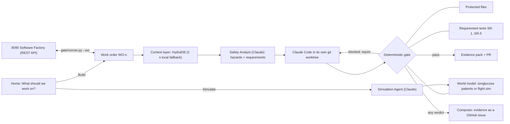

# Certus Factory

**A software factory for safety-critical code.** You say what you want in plain English. An agent team recalls the
organization's memory (HydraDB), maps the request to hazards, and has Claude Code write the change in its own git
worktree. Then deterministic checks decide whether it ships:

- the test behind every safety requirement the diff touches (e.g. SR-1 "single bolus never exceeds 10 U", hazard H-1 overdose);
- a world model that runs the candidate's real compiled C code in simulation: simulated type 1 diabetic patients
  (simglucose) for the insulin pump, simulated 737-class aircraft for flight controls.

If a check fails, the report goes back to the agent. If everything passes, the change ships with a safety evidence
pack and a PR, and Composio files the evidence on GitHub. Approval is never an LLM decision. The project is modelled
on 8090's Software Factory and adds CertusAI-style safety traceability.

**Why not just Claude Code?** Claude is the builder; we're the inspector. Claude Code writes the change, and the
factory adds what a regulated team needs before merge:

- a deterministic gate the LLM can't talk past, made of tests and exit codes the agent can't edit;
- simulation evidence that the real code doesn't harm a simulated patient or aircraft;
- traceability from request to hazard to requirement to test to PR;
- an evidence pack for every change, including the blocked ones.

Built at EVOLVE, the 8090 AI Hackathon (Nov 13–14, 2026). Devpost write-up: [docs/DEVPOST.md](docs/DEVPOST.md).
Hosted read-only backup: https://certus-factory.vercel.app

## Architecture



The LLM steps plan, write code and suggest hazards. Only the exit codes of the project's checks decide approval:
`gate/checks.json` for the pump, `gate/checks-aircraft.json` for flight controls. If an LLM or sponsor call fails, the
run continues with a fallback and the UI says so.

The final PASS/BLOCKED is decided by a small Rust binary (`gate-rs/`, `#![forbid(unsafe_code)]`, no panics, property
tests). It takes the rule table, the check outcomes, the requirement test results and the world-model results, and
returns every requirement with its hazard links plus a SHA-256 verdict digest. Without cargo, the identical Python
reference in `gate/verdict.py` decides, and `gate/test_gate.py` checks that the two agree on every recorded run.

## Projects

Pick a project with the project switcher in the sidebar.

| Project | Code | Hazards / standards | World model | Stage request |
|---|---|---|---|---|
| Insulin Pump Firmware | `demo/pump/` (small C controller, not a medical device) | H-1..H-5, SR-1..SR-5; IEC 62304 / ISO 14971 | `sim/world.py`: simglucose, 10 virtual adults, large meal + 10x dose typo over 12 h; blocks on any new BG < 54 mg/dL | `Raise the single-bolus limit to 25 U` |
| Boeing Flight Controls | `demo/aircraft/` (AoA stall protection in C, built at the hackathon) | H-1..H-5 with severity and DAL (ARP4761 FHA), SR-1..SR-5 with DO-178C objectives; context in [docs/BOEING.md](docs/BOEING.md) | `sim/flight.py`: plain-Python longitudinal flight model, 3 scenarios x 6 configs; blocks on any new stall or altitude-loss exceedance | `Add AoA disagree alert when the two sensors differ by more than 5 degrees` |

The aerospace project exists because Boeing asked CertusAI about DO-254. Boeing is not a customer, and this isn't
Boeing code or data.

## Quickstart

**Prerequisites:**

- macOS or Linux with Python 3.10+, Node 18.18+ and npm, `make`, a C compiler, and `git`.
- For live mode: the `claude` CLI logged in, or `ANTHROPIC_API_KEY` set.
- To open PRs: the `gh` CLI.

```bash
git clone https://github.com/Abhishek21g/evolve-factory && cd evolve-factory
demo/go.sh replay      # first run ~1.5 min (venv, npm ci, UI build), then ~3 s; ends with READY
```

Then open one of these:

- **Pump:** http://localhost:8787/#/p/insulin-pump-firmware/overview. Type `Raise the single-bolus limit to 25 U` and press Enter.
- **Aircraft:** http://localhost:8787/#/p/boeing-flight-controls/overview. Type the AoA request above.

The `go.sh` modes:

- `demo/go.sh replay` plays each project's recorded real run, so nothing waits on an LLM. It needs no keys.
- `demo/go.sh live` runs real agents and pre-warms every Home suggestion in the background. A cold work order takes a few minutes, and a what-if about a minute; repeats answer instantly from their cached real run.
- `demo/go.sh check` runs the health check only.

`go.sh` creates `.venv`, builds `web/`, seeds the projects and a draft work order, pre-warms the simulator and the C
build, starts `factory/server.py`, and prints READY or exactly what's broken. Re-running it is safe.

You can override these settings with environment variables:

- `PORT` (default 8787).
- `FACTORY_PR=1`: live runs open a GitHub PR.
- `REPLAY_SPEED`, `REPLAY_HOLD`: replay pacing (see [docs/DEMO.md](docs/DEMO.md)).

**Keys (optional).** Put them in `.env` at the repo root; it's gitignored. Without keys, the factory runs on local fallbacks.

| Name | Used for |
|---|---|
| `ANTHROPIC_API_KEY` | Live mode: Claude Code, Safety Analyst, Simulation Agent (otherwise the logged-in `claude` CLI) |
| `HYDRADB_API_KEY` | Org memory recall in HydraDB; seeded from local memory on server start (otherwise a local JSONL store). Optional: `HYDRADB_DATABASE` |
| `COMPOSIO_API_KEY` | Files each verdict's evidence pack as a GitHub issue. Connect GitHub once: Home → **Connect GitHub**. Optional: `COMPOSIO_USER_ID` |
| `SF_API_KEY` | 8090 Software Factory External API (`sofa-ext-...`); check with `python3 gate/sf.py health` |

## Demo flow (3 minutes)

The full script is in [docs/DEMO.md](docs/DEMO.md), and the spoken pitch is in [docs/PITCH.md](docs/PITCH.md).

1. **Home (pump).** Type the request with **Build** selected. A work order opens, and the hazard analysis maps it to H-1, H-2 and H-3. It flags that the request violates SR-1.
2. **Blocked.** Attempt 1 is the obvious patch `MAX_BOLUS_U 10 -> 25`, scripted by `demo/obvious_patch.sh`, because Claude Code wouldn't write it. SR-1 fails, and 4 simulated patients newly fall below 54 mg/dL.
3. **Blocked again.** Attempt 2 is real Claude Code's extended bolus. All 5 tests pass, but 2 patients crash hours after a large meal.
4. **Green.** Attempt 3 is real Claude Code capping the extended total. 5/5 tests pass and there are 0 new severe lows. Open **Evidence**, **Pull request** ([#30](https://github.com/Abhishek21g/evolve-factory/pull/30)) and **Simulations**.
5. **Aircraft.** Switch project and send the AoA request.
   - Attempt 1 is the obvious patch: it lowers the certified 5.5 deg monitor to 5 deg, scripted by `demo/aircraft/obvious_patch.sh`. SR-3 fails, and all 6 aircraft stall in the sideslip approach.
   - Attempt 2 is Claude Code adding a separate alert-only threshold. 5/5 pass, 0 new exceedances ([#41](https://github.com/Abhishek21g/evolve-factory/pull/41)).
6. **Optional.** Switch to **Simulate** and ask a what-if, or open **Agents** (each agent's page) and **Memory**.

## What's in the UI

| Page | What it shows |
|---|---|
| Home | Greeting, one "What should we work on?" box with Build / Simulate, suggestions, the agent team, and HydraDB / Composio connection status |
| Agents | Working team view. Each agent's page shows now, live log, output, skills and history |
| Memory | Search and add org memory (tickets, meeting notes, chats, emails, code notes, past runs) |
| Work Orders | Each run: hazard analysis, attempts, gate matrix, world model, evidence pack, code change, PR |
| Simulations | Real charts per simulated run. Pump: glucose per virtual patient, candidate vs `main`, the 70–180 band, the 54 and 250 lines, insulin delivered by `pump.c`, pass/fail per patient. Aircraft: AoA vs the stall line |
| Requirements, Traceability, Audit trail | Hazard log; a clickable trace matrix and graph per project: regulation clause → hazard → requirement → code lines → test → simulation scenario → work order → evidence. Code opens at the exact lines (and on GitHub), docs open at the section; people add or remove links (saved to `trace/links-<device>.json`); gaps auditors look for are flagged red. Who (human or agent) did what |

## Run the pieces on their own

```bash
.venv/bin/python gate/test_gate.py                            # gate self-test, incl. Rust/Python verdict parity
.venv/bin/python factory/test_tracelinks.py                 # trace file endpoint traversal guard + link validation
(cd gate-rs && cargo test --release)                          # Rust verdict layer: unit + property tests
make -s -C demo/aircraft test                                 # aircraft requirement tests
.venv/bin/python sim/world.py --repo . --base main            # pump world model on main, ~25 s
.venv/bin/python sim/flight.py --repo . --base main           # flight world model on main, ~1 s
.venv/bin/python factory/memory.py stall protection AoA       # org memory recall (HydraDB if the key is exported)
.venv/bin/python factory/pipeline.py whatif "What if an adult eats 150 g of carbs?"   # needs Claude; else a parsed fallback
```

## Repo layout

| Path | What's in it |
|---|---|
| `factory/` | `server.py` (API and static UI), `pipeline.py` (build / what-if / replay / pre-warm), `memory.py` (HydraDB + local fallback), `actions.py` (Composio), `store.py` (projects, work orders, audit trail), `seed_memory.jsonl` (example org memory written for the demo) |
| `gate/` | `runner.py` (Claude Code in a worktree, retry on BLOCKED, PR), `gate.py` (diff to requirements to tests), `verdict.py` (verdict layer: Rust binary or Python reference), `check_protected.py`, `checks.json` / `checks-aircraft.json`, `sf.py` (Software Factory REST client) |
| `sim/` | `world.py` + `shim.c` (pump in simglucose), `flight.py` + `fcc_shim.c` (flight model), `agent.py` (standalone Simulation Agent on the Anthropic API) |
| `demo/pump/`, `demo/aircraft/` | The two codebases: C code, `safety.json` (hazards and requirements), requirement tests, obvious patches; `demo/aircraft/RULES.md` (coding-agent rules) |
| `demo/` | `go.sh`, `health.py`, `replay/` (recorded runs per project), `record.py`, `deploy.sh` (Vercel) |
| `web/` | Static Next.js UI |
| `dashboard/` | Earlier agent control room and the shared event feed (`emit.py`) |
| `docs/` | `PLAN.md`, `DEMO.md`, `PITCH.md`, `DEVPOST.md`, `BOEING.md`, `SAFETY_GATE.md`, `RESEARCH.md` |

## Tools, libraries and licenses

| Tool / library | Use | License |
|---|---|---|
| Python 3 standard library | server, gate, pipeline, flight model | PSF |
| git, make, C compiler (clang/gcc) | worktrees, diffs, building the C code | tools only, not bundled |
| Claude Code (Anthropic) | coding agent in the loop; also used to build this project | Anthropic commercial terms |
| Anthropic Python SDK (anthropic 2.8.0) + Claude API | Simulation Agent (`sim/agent.py`) | MIT SDK; API under Anthropic commercial terms |
| 8090 Software Factory (External REST API) | work orders, status, PR link (`gate/sf.py`) | 8090 service (event access) |
| simglucose 0.2.11 (UVA/Padova T1D simulator) | pump world model | MIT |
| numpy, pandas, scipy (simglucose deps) | simulation | BSD-3-Clause |
| Next.js 15, React 19, Tailwind CSS 4 | web UI | MIT |
| HydraDB (hydradb-sdk) | org memory / context layer | proprietary SDK, hosted service (sponsor) |
| Composio (composio 0.32) | files evidence packs as GitHub issues | Apache-2.0 (sponsor) |
| Vercel | hosting the read-only UI | service (sponsor) |
| GitHub CLI (`gh`) | opening PRs | MIT, tool only |
| Cursor, Codex CLI | IDE and coding agents used while building | proprietary / Apache-2.0 |

## Built before the event

Nothing. All code and commits in this repo were made during EVOLVE (hacking started Fri Nov 13, 7:10 PM PT). Ideas
were planned beforehand, which the rules allow. No code from CertusAI (our separate startup) is used.

Team: Abhishek Enaguthi ([@Abhishek21g](https://github.com/Abhishek21g)), Muralikrishna Inti ([@Muralikinti](https://github.com/Muralikinti)).

## License

MIT, see [LICENSE](LICENSE).
